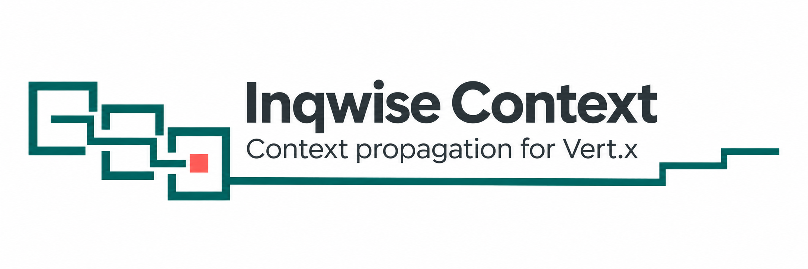

= Inqwise Context

image:https://github.com/inqwise/inqwise-context/actions/workflows/ci.yml/badge.svg[CI, link=https://github.com/inqwise/inqwise-context/actions/workflows/ci.yml]
image:https://img.shields.io/maven-central/v/com.inqwise/inqwise-context.svg?label=Maven%20Central[Maven Central, link=https://central.sonatype.com/artifact/com.inqwise/inqwise-context]
image:https://img.shields.io/badge/Java-21%2B-blue.svg[Java 21+, link=https://openjdk.org/projects/jdk/21/]

*Keep flow metadata available across asynchronous Vert.x calls, without passing it through every method.*

Set a `FlowId` when work begins. Read it in the receiving service and again when the reply arrives. EventBus integration is automatic, including calls made through ServiceProxy.

[source,text]
----
Sender                    Receiver                 Sender's reply callback
create FlowId     ->      read the same ID    ->    read the original FlowId
----

Use it for correlation IDs, tenant metadata, or small application-owned context objects. Within a context, storage keeps the object reference; across a wire, the receiver gets a decoded value, not the same Java object.

== Quick Start

You need Java 21+ and a Vert.x 5 application. Add the library, setting `latest.version` to the release you use:

[source,xml]
----
<dependency>
    <groupId>com.inqwise</groupId>
    <artifactId>inqwise-context</artifactId>
    <version>${latest.version}</version>
</dependency>
----

Your application supplies Vert.x Core and Guava, plus Log4j Core or an existing compatible logging setup. Keep the library's `META-INF/services` registrations when packaging an executable JAR; they enable automatic EventBus integration.

=== Try A Request And Reply

This complete example deploys two verticles and sends one request. No manual interceptor setup or `runOnContext` wrapper is needed.

[source,java]
----
import com.inqwise.context.FlowIdContext;
import io.vertx.core.Future;
import io.vertx.core.VerticleBase;
import io.vertx.core.Vertx;

public final class QuickStart {
    public static void main(String[] args) {
        Vertx vertx = Vertx.vertx();
        vertx.deployVerticle(new Receiver())
            .compose(id -> vertx.deployVerticle(new Sender()))
            .onFailure(Throwable::printStackTrace)
            .onComplete(ignored -> vertx.close());
    }

    static final class Receiver extends VerticleBase {
        @Override
        public Future<?> start() {
            return vertx.eventBus().<String>consumer("orders", message -> {
                System.out.println("Receiver: " + FlowIdContext.require().getId());
                message.reply("done");
            }).completion();
        }
    }

    static final class Sender extends VerticleBase {
        @Override
        public Future<?> start() {
            System.out.println("Sender: " + FlowIdContext.getOrCreate().getId());
            return vertx.eventBus().<String>request("orders", "order-42")
                .onSuccess(reply ->
                    System.out.println("Reply: " + FlowIdContext.require().getId()));
        }
    }
}
----

*All three lines print the same ID.* `getOrCreate()` explicitly starts the identity; the receiver and reply callback only read it.

== The Operations You Need First

Use these inside a deployed verticle callback or handler, where a Vert.x context is active:

[source,java]
----
FlowIdContext.getOrCreate(); // initialize once, or keep the current identity
FlowIdContext.get();         // read; null if no identity is stored
FlowIdContext.require();     // read; fail if an identity is required but missing
----

The library does not create an identity on every read. Your application decides where a flow starts. Do not call storage directly from ordinary Java threads; bind external callbacks from the originating Vert.x context, as shown in the practical guide.

== Go Further

[cols="1,2",options="header"]
|===
|What you want to do |Where to start
|Replace or remove a FlowId; use ServiceProxy |link:docs/usage.adoc#_flowid_in_application_code[Everyday FlowId usage]
|Carry metadata through internal HTTP or Kafka |link:docs/usage.adoc#_connect_services[Service integration examples]
|Use timers or a foreign-thread async client |link:docs/usage.adoc#_timers_and_external_callbacks[Callback examples]
|Add your own item, map, set, or list |link:docs/usage.adoc#_add_application_metadata[Typed application metadata]
|Write codecs, customize factories, or choose transport defaults |link:docs/advanced.adoc[Expert guide with SPI examples]
|===

EventBus is automatic. HTTP and Kafka require opt-in adapters and destination allowlists. Redis and Elasticsearch callback binding preserves local context; it does not send metadata through those protocols.

Keep metadata small and treat received values as untrusted. Context metadata is not authentication or authorization. FlowId replies preserve the caller's existing identity; custom items can choose a different return policy.

== Documentation

Follow link:docs/index.adoc[the documentation guide] for the full reading path. Detailed contracts, protocol limits, test coverage, security, and contributor/release instructions live there, away from the quick start.

== License

link:LICENSE[MIT License]. Inspired by https://github.com/reactiverse/reactiverse-contextual-logging[reactiverse-contextual-logging].
